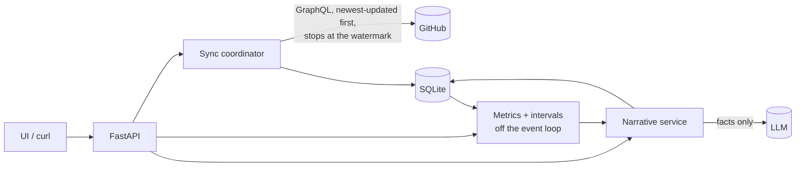
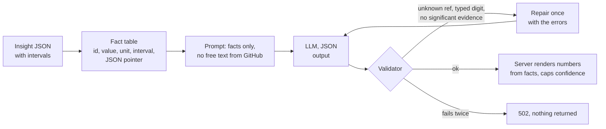

# Review Flow

Review Flow reads a GitHub repository's pull requests and reviews and answers two
questions for any period: **who is carrying code review, and how long do PRs wait for
it?** It compares the period with the one before it, attaches a 95% interval to every
change so noise is not mistaken for a trend, and splits a change in wait time into
"different PRs were merged" versus "the same kinds of PR waited longer".

A second endpoint asks an LLM to explain what changed: a short narrative, a root-cause
hypothesis, a confidence score and an evidence chain back to the numbers. Statistics
decide what moved; the model only explains it, and every number it shows is rendered by
the server from the computed metrics.

From a real run on `astral-sh/uv`, October 2026:

> **More PRs merged, fewer reviewed, as most now skip review.**
> With merge volume up and review pairs down, PRs increasingly bypassed review instead of
> queueing for it, which mechanically removed the review wait and halved the median cycle
> while leaving first-review time flat. The shorter cycle is therefore not faster
> reviewing; it is less reviewing. *(confidence 0.55; evidence: merged PRs, PR reviews,
> share merged without review and median cycle time, each a significant change)*

## Features

- **Review-flow metrics** over GitHub's GraphQL API: wait for first review (p50/p90),
  review-to-merge and cycle time, unreviewed merges, reviewer load and concentration,
  segments by PR size and author type, with links to the PRs behind the numbers.
- **Uncertainty on every change:** bootstrap and Poisson intervals, a significance flag,
  and a mix/within decomposition of the change in wait time.
- **Grounded LLM narrative:** the model references facts instead of typing numbers, a
  validator rejects anything unverifiable, and a hypothesis needs a significant change
  behind it. Talks to any OpenAI-compatible Chat Completions API; evaluated on
  DeepSeek V4.1 Flash.
- **Production basics:** incremental sync into SQLite, per-repository sync locking, ETags,
  RFC 9457 errors, request IDs, structured logs, no secrets in logs or responses.
- **Evals:** planted-cause simulations measure accuracy, abstention, grounding and
  calibration of the narrative; results in [`evals/results.md`](evals/results.md).
- **Demo UI** at `/`, with no build step.

## Getting started

### Prerequisites

- A GitHub [fine-grained token](https://github.com/settings/personal-access-tokens/new)
  with **Public repositories (read-only)** access and nothing else.
- For the narrative (optional): an API key for an OpenAI-compatible LLM endpoint.
- Docker, or Python 3.12+ with [uv](https://docs.astral.sh/uv/).

### Configure

```bash
cp .env.example .env
```

Set `GITHUB_TOKEN`, then point the narrative at your LLM provider:

| Provider | `LLM_BASE_URL` | `LLM_MODEL` | `LLM_JSON_MODE` |
|---|---|---|---|
| DeepSeek on Deploy (tested) | `https://api-sf1-cdn.deploy.com/api/v1` | `deepseek-ai/deepseek-v4.1-flash-1017` | `json_schema` |
| DeepSeek (defaults) | `https://api.deepseek.com` | `deepseek-flash` | `json_object` |

plus `LLM_API_KEY` for that provider. Any other OpenAI-compatible Chat Completions
endpoint takes the same three settings; use `json_schema` where the provider supports
schema-constrained output and `json_object` otherwise. Without a key the metrics endpoint
works and the narrative endpoint returns `503`.

### Run

With Docker:

```bash
docker compose up --build            # http://localhost:8000
```

Or locally:

```bash
uv sync
uv run python -m reviewflow          # http://127.0.0.1:8000
```

Open http://localhost:8000, enter a repository such as `pydantic/pydantic` or
`astral-sh/uv`, and pick a period. The first query for a repository waits while its PR
history is fetched (seconds, up to a few minutes for very busy repositories); repeats are
served from SQLite, and a narrative for the same data is served from cache.

## API

Interactive reference at `/docs`. Both endpoints take `since` and `until` (ISO 8601 dates
or datetimes, UTC if no offset; defaults: the last 30 days) and compare the period with
the one of equal length before it.

```bash
# Metrics
curl "localhost:8000/v1/repos/pydantic/pydantic/insights/review-flow?since=2026-10-01&until=2026-11-01"

# Narrative with hypothesis, confidence and evidence
curl "localhost:8000/v1/repos/pydantic/pydantic/insights/review-flow/narrative?since=2026-10-01&until=2026-11-01"
```

| Status | Meaning |
|---|---|
| 200 | Result. The metrics response carries an `ETag`; send `If-None-Match` to get `304`. |
| 403 | Repository not in `ALLOWED_REPOS` (when set). |
| 404 | Repository does not exist or is not visible to the token. |
| 422 | Invalid owner/repo name, period (too long, or `since` beyond `MAX_LOOKBACK_DAYS`), or `top`. |
| 502 | GitHub or the LLM provider failed, or the model's answer failed grounding checks twice. |
| 503 | GitHub or LLM provider rate limited or overloaded (with `Retry-After`), or `LLM_API_KEY` not set. |

Errors are [RFC 9457](https://www.rfc-editor.org/rfc/rfc9457) `application/problem+json`
with a `request_id` that matches the `X-Request-ID` header and the logs.

## How it works



A request validates its input, asks the sync coordinator to make sure SQLite covers the
period and the one before it (fetching only PRs updated since the last sync), computes
the metrics, and for the narrative turns them into a fact table for the model. Design
decisions and trade-offs are in [NOTES.md](NOTES.md).

### The metrics, and why these

Commit or merge counts reward volume. Review is where teams actually queue: a PR that
waits two days for anyone to look at it costs its author context and the team
throughput, and the cause is usually visible in the data (one person doing most reviews,
that person going quiet, large PRs, external contributors at the back of the queue). So
the insight is **review flow**: how long work waits for review, and how review load is
distributed, compared with the previous period so the change is the headline rather than
the level.

| Metric | Definition |
|---|---|
| Wait for first review (`ttfr`) | Hours from *ready for review* to the first review by someone other than the author. PRs opened as drafts are measured from their first ready-for-review event, not creation; PRs opened ready and later converted to draft keep their creation time. p50 and p90. |
| First review to merge | Hours from that first review to merge: iteration time, separate from queue time. |
| Ready to merge (cycle) | Hours from ready for review to merge. |
| Merged without review | Share of merged PRs with no review before the merge. |
| PR reviews | One reviewer reviewing one PR, however many rounds. Used for load so a reviewer who leaves ten comments on one PR does not outrank one who reviewed ten PRs. |
| Busiest reviewer's share, review bus factor | Concentration of review load: the top reviewer's share, and the fewest reviewers who together did half of all PR reviews. |
| Segments | Wait for first review by PR size (under 100, 100–499, 500+ lines) and by author (write access vs. other contributors), relative to the overall median. |

**Is a change real?** Every `summary` change and every reviewer's change in PRs reviewed
carries `delta_ci`, a 95% interval, and `significant` (the interval excludes zero).
Medians and shares use a percentile bootstrap (1,000 resamples, fixed seed so responses
are reproducible); counts use a Poisson interval. Intervals are null below 8 observations
per period (50 for p90s), where they would mostly reflect the method. Active reviewers and
bus factor have none.

**What moved the wait?** `drivers` splits the change in median wait for first review two
ways, by PR size and by author type. The counterfactual reweights this period's PRs to
last period's mix (the median the period would have had with the old mix of PRs):
`mix` is the part explained by different kinds of PR being merged, `within` the part
explained by the same kinds of PR waiting longer. They add up to the change, and each has
a bootstrap interval.

Two populations, on purpose:

- **Flow metrics use PRs merged in the period.** Their lifecycle is complete, so medians
  are not biased by still-open PRs that have been waiting a long time (right-censoring).
- **Reviewer load uses reviews submitted in the period**, on any PR, because review work on
  a long-lived or bot-authored PR is still review work.

Excluded everywhere: bot accounts (GitHub `Bot` actors), and an author's own "reviews"
(GitHub records an author's replies to review threads as `COMMENTED` reviews by the
author; counting them would make every PR look reviewed instantly). Bot-authored PRs are
counted separately and left out of flow metrics.

Each response includes the slowest PRs and unreviewed merges with links, so any number
can be checked against GitHub.

### How the narrative stays grounded



- The model writes `{{summary.ttfr_p50_hours.current}}`, `{{@login}}` or `{{#1234}}`
  where it wants a number, a reviewer or a PR. The validator rejects unknown references and
  any digit typed outside one, gives the model one chance to fix it, and otherwise returns
  `502`. Readers never see a number the server did not compute.
- Each evidence item carries the fact's value and a JSON pointer (`source`) into the
  metrics response, so the chain runs narrative → fact → metric → PR links.
- Facts that are changes carry their interval and a significant / not significant
  verdict in the prompt. A hypothesis needs at least two facts, **at least one of them a
  significant change**; the validator enforces it, so with no real change the answer has
  no hypothesis.
- **Confidence** is `min(model's stated confidence, a ceiling set by sample size)`.
  Self-reported confidence is not calibrated, so the service bounds it: 0.35 under 10
  merged PRs, 0.6 under 30 (or under 10 in the previous period), 0.85 otherwise. Both
  numbers and the reason are returned.
- Only numbers and constrained identifiers (logins, PR numbers) reach the prompt. PR
  titles and bodies never do, which removes the prompt-injection path rather than trying to
  filter it.
- Results are cached by a hash of every input (prompt version, model, facts), so identical
  questions cost one call and need no invalidation; identical requests in flight at the
  same time share one generation.

## Configuration

| Variable | Default | |
|---|---|---|
| `GITHUB_TOKEN` | required | Read-only token. Never logged or returned. |
| `LLM_API_KEY` | unset | Enables the narrative endpoint; without it, that endpoint returns 503. |
| `LLM_BASE_URL` | `https://api.deepseek.com` | Any OpenAI-compatible Chat Completions API. |
| `LLM_MODEL` | `deepseek-flash` | Model for the narrative. |
| `LLM_JSON_MODE` | `json_object` | `json_object` (JSON mode, schema in the prompt; supported almost everywhere) or `json_schema` (decoding constrained to the schema, where the provider supports it). |
| `ALLOWED_REPOS` | any | Comma-separated `owner/repo` list this instance will query. |
| `SYNC_TTL_SECONDS` | 600 | How stale stored data may be before a query refreshes it. |
| `DEFAULT_WINDOW_DAYS` / `MAX_WINDOW_DAYS` | 30 / 180 | Period default and limit. |
| `MAX_LOOKBACK_DAYS` | 365 | How far back `since` may reach; bounds the history one request can make the service fetch. |
| `DATABASE_PATH` | `data/reviewflow.db` | SQLite file (`/data/reviewflow.db` in Docker, on a volume). |

## Development

```bash
make check    # ruff, mypy --strict, offline tests (fake GitHub, scripted LLM)
make eval     # narrative evals against the configured LLM; writes evals/results.md
```

`make eval` simulates eight repositories, each over three seeds: six with a planted cause
(a key reviewer leaves, PRs get larger, contributors wait longer, contributors become a
larger share of PRs, load concentrates on one reviewer, volume doubles) and two where
nothing changed (one busy, one quiet). It reports accuracy (the hypothesis cites the facts
carrying the planted signal), abstention when nothing changed, grounding and repair rates,
and the Brier score of the model's and the capped confidence, and writes them to
`evals/results.md`. A test checks offline that every planted cause is statistically
visible for every seed, so a failing eval is the model's failure, not the simulation's.

### Project layout

```
reviewflow/
  api.py          routes, validation, ETags
  github.py       GraphQL client: paging, review overflow, retries, rate limits
  sync.py         incremental ingestion, coverage watermark, one sync at a time per repo
  store.py        SQLite schema and queries
  metrics.py      review-flow computation (pure functions)
  stats.py        intervals and the mix/within split of a change
  schemas.py      response models; field descriptions are the metric definitions
  narrative/      facts, prompt, output contract + validator, LLM client, service
  static/         the demo UI (no build step)
evals/            planted-cause scenarios, the eval runner and its last results
tests/            unit and API tests against a fake GitHub and a scripted LLM
```
